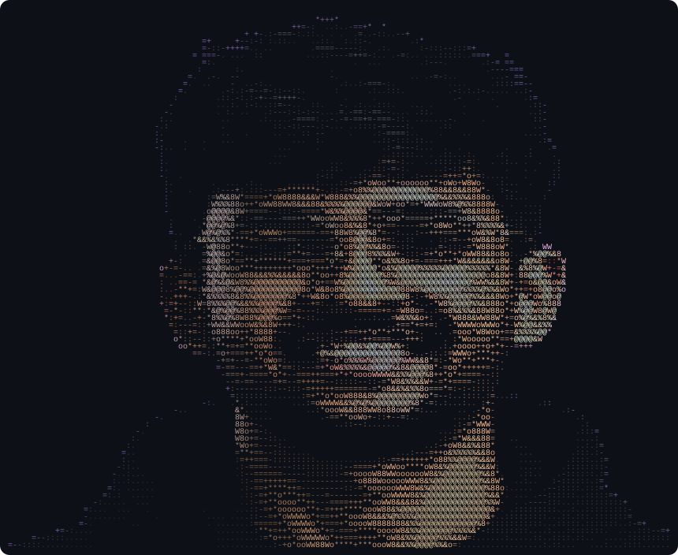

<!-- ===================== HERO ===================== -->

  

  <h1>Hi , I'm Akshat Singh Nayal</h1>
  <h3>A Student from Lucknow 🇮🇳</h3>

  

  

    🔭 Working on <b>Developing Problem Solving Skills</b> 
    🌱 Learning <b>GenAI | Agentic RAG</b> 
    💬 Ask me about <b>Problem Solving | GenAI | RAG</b> 
    📫 <a href="mailto:programmer.akshat@gmail.com">programmer.akshat@gmail.com</a> &nbsp;•&nbsp; <a href="https://www.linkedin.com/in/akshatnayal">LinkedIn</a>
  

 

<!-- ===================== STATS ===================== -->

  <h3>📊 GitHub Stats</h3>
  

    
    
  

 

<!-- ===================== LANGUAGES & TOOLS ===================== -->

  <h3>🛠️ Languages and Tools</h3>
  

 

<!-- ===================== CONNECT ===================== -->

  <h3>🤝 Connect With Me</h3>
  
  
  
  
  

 

<!-- ===================== PAC-MAN ===================== -->

  <picture>
    <source
      media="(prefers-color-scheme: dark)"
      srcset="https://raw.githubusercontent.com/akshatsinghnayal/akshatsinghnayal/output/pacman-contribution-graph-dark.svg"
    >
    <source
      media="(prefers-color-scheme: light)"
      srcset="https://raw.githubusercontent.com/akshatsinghnayal/akshatsinghnayal/output/pacman-contribution-graph.svg"
    >
    
  </picture>

